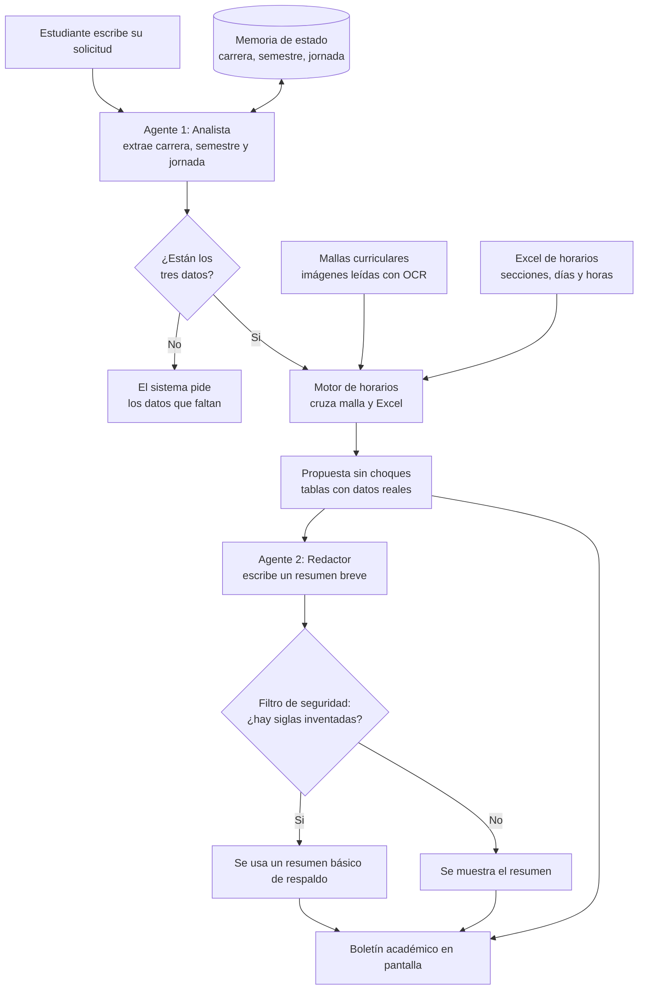

# Portal Académico: Asistente de Horarios (Prototipo 5)

Asistente web que ayuda a un estudiante de Duoc UC a armar su horario de clases. El estudiante escribe su solicitud con palabras normales y el sistema responde con una propuesta de horario sin choques entre asignaturas.

> Ejemplo de solicitud: *"Soy de Desarrollo, paso a 4to semestre en jornada Diurna."*

## Novedades de este prototipo

- **Agentes de inteligencia artificial:** ahora el sistema usa dos agentes con tareas separadas. Uno entiende el mensaje del estudiante y el otro redacta el resumen de la propuesta.
- **Memoria de estado:** el sistema recuerda la carrera, el semestre y la jornada entre mensajes. Después de la primera consulta basta con escribir algo como "¿y en vespertino?", sin repetir todos los datos.
- **Interfaz renovada:** la página ahora tiene una caja de solicitud, un botón de envío y una zona llamada "Tu Boletín Académico" con el resumen, el horario semanal y el detalle de secciones, con los colores corporativos de Duoc UC.
- **Lectura de mallas por tarjetas:** las mallas curriculares se leen detectando cada tarjeta de asignatura, y también se reconocen los cupos electivos (Formación Cristiana, Competencias Globales y Optativos).

## Cómo funciona

El sistema combina dos fuentes de información: las **mallas curriculares** (imágenes), que indican qué asignaturas corresponden a cada semestre, y un **Excel de horarios**, que indica en qué días y horas se dicta cada sección. El motor de horarios cruza ambas fuentes y busca la combinación que ubica más asignaturas sin superposición.

### Los dos agentes

| Agente | Qué hace | Qué no puede hacer |
|---|---|---|
| Agente 1: Analista | Lee el mensaje y extrae carrera, semestre y jornada. | Inventar datos que el estudiante no dijo. |
| Agente 2: Redactor | Escribe un resumen de máximo 4 oraciones. | Nombrar siglas, docentes u horarios que no estén en los datos verificados. |

**Principio de diseño:** la inteligencia artificial no inventa datos. Todo lo que aparece en las tablas sale de la malla y del Excel, calculado con Python. Además, el resumen del Agente 2 pasa por un filtro que lo descarta si menciona una sigla que no existe.

## Estructura del cuaderno

| Sección | Qué hace |
|---|---|
| 1. Instalación | Instala Tesseract y las librerías necesarias. |
| 2. Conexión | Conecta con la IA (Groq) y carga el Excel. |
| 3. Preparación | Convierte los horarios en números y crea el catálogo de siglas. |
| 4. Herramientas de lectura | Define las funciones para leer las mallas (aún no las ejecuta). |
| 5. Procesamiento de mallas | Lee las siete mallas y muestra un resumen para control de calidad. |
| 6. Motor de horarios | Cruza malla y Excel y arma el horario sin choques. |
| 7. Sistema multi-agente | Define los dos agentes, la memoria y el flujo de la conversación. |
| 8. Estilos visuales | Define colores y diseño de la página. |
| 9. Interfaz gráfica | Construye la página web con Gradio. |
| 10. Lanzamiento | Pone en marcha el portal y genera un enlace público. |

## Requisitos

- Cuenta en Google Colab.
- Archivo `HORARIOS_SIMULADOS_CORREGIDO.xlsx` con las hojas `BASE` y `OPTATIVOS COMPETENCIAS GLOBALES`.
- Las siete imágenes de mallas curriculares en formato `.jpg`, con los nombres que aparecen en la sección 5 del cuaderno.
- Una clave de API de [Groq](https://groq.com), guardada en los Secretos de Colab con el nombre `OPENAI_API_KEY`.

## Cómo ejecutarlo

1. Abre el cuaderno `.ipynb` en Google Colab.
2. Carga el Excel y las imágenes de las mallas en los archivos de Colab.
3. Agrega la clave de API en los Secretos de Colab.
4. Ejecuta las celdas en orden, de arriba hacia abajo.
5. Revisa el resultado de la sección 5 y compáralo con las imágenes originales.
6. Al ejecutar la última celda se genera un enlace público (`gradio.live`). Ábrelo y escribe tu solicitud.

## Limitaciones

- Es un prototipo: la lectura de las mallas depende de la calidad de las imágenes, por eso se recomienda revisar el control de calidad de la sección 5.
- El enlace público dura aproximadamente una semana y se desactiva al cerrar o reiniciar Colab.
- Los cupos electivos muestran opciones sugeridas tomadas del Excel; la elección final corresponde al estudiante.
- Si una asignatura no aparece en el Excel, el sistema lo informa en lugar de inventar un horario.

## Tecnologías

Python, Google Colab, Gradio, Pandas, OpenCV, Tesseract OCR y Groq (modelo `openai/gpt-oss-120b`).
